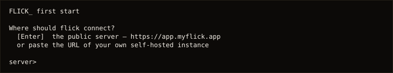
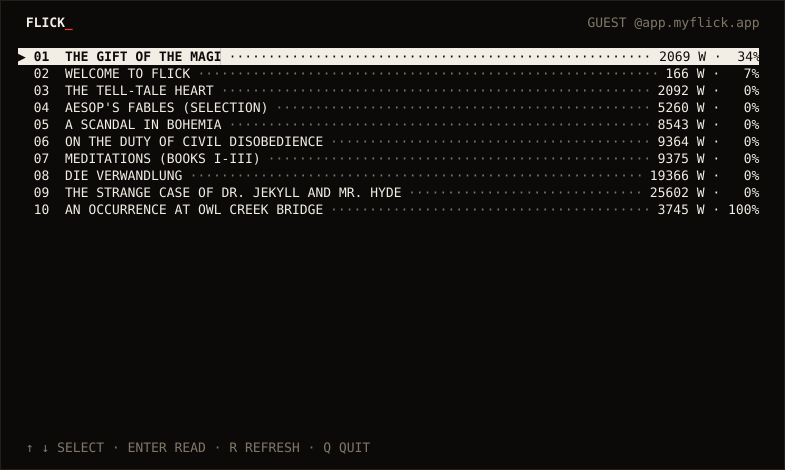
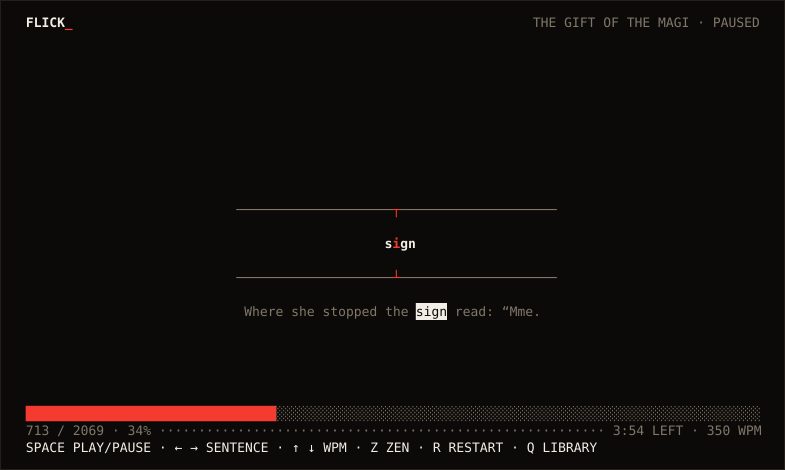
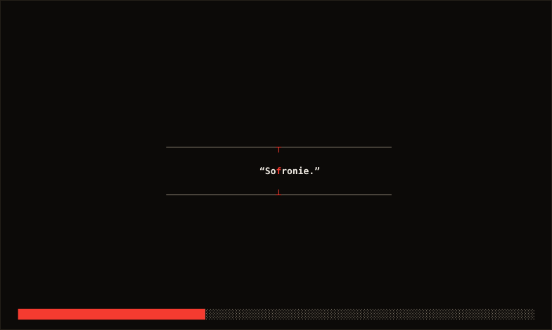

<h1 align="center">FLICK_ <sub>tui</sub></h1>

<p align="center">
RSVP speed reading in your terminal — one word at a time, eyes still.
</p>

<p align="center">
<a href="https://github.com/one-more-refactor/flick-tui/actions/workflows/ci.yml"></a>


</p>

<p align="center">

</p>

Words are flashed at a fixed focal point with the ORP (optimal recognition
point) letter pinned in place, so your eyes stop jumping and just read.
Pacing comes from a research-grounded weight model — rare words, numbers,
and sentence ends get more time. The engine runs server-side; this client
plays the resulting reading timelines.

## Install

```sh
cargo install --git https://github.com/one-more-refactor/flick-tui
```

On first start it asks where to connect — press Enter for the public
server, or paste the URL of your own self-hosted instance:

<p align="center">

</p>

No account needed. A guest session is created automatically and your
library, positions, streaks and stats live on the server — shared with the
web app at [app.myflick.app](https://app.myflick.app) and any other client.

## Your library, in a list

Every library starts pre-seeded: a short interactive intro plus a shelf of
public-domain classics. In progress first, then unread, then finished.

<p align="center">

</p>

## The reader

Pause and the current sentence appears under the stage — the word you were
on marked, so you never lose the thread. Every play start ramps from 60% to
full speed over ~3 seconds, like a motor. Losing terminal focus pauses
playback; an unfocused terminal never fast-forwards through unseen words.

<p align="center">

</p>

And when you want nothing but the words — `z`:

<p align="center">

</p>

## Use

```sh
flick-tui              # browse and read your library
flick-tui notes.md     # upload a text/markdown file and read it now
cat article.txt | flick-tui -   # same, from stdin
flick-tui login        # sign in (your guest library merges into the account)
flick-tui logout
flick-tui --server https://flick.example.org   # use your own instance
```

| key | action |
|---|---|
| `Space` | play / pause (never autoplays; restarts at the end) |
| `←` / `→` | back / forward one sentence |
| `↑` / `↓` | WPM ±25, 100–1200 (synced to your account) |
| `z` | zen mode — word and progress only |
| `r` | restart the book |
| `q` / `Esc` | back to library / quit |

Reading progress reports to the server every few seconds while playing, so
streaks and stats count terminal reading like any other client.

## Config

`~/.config/flick/tui.json` — the server URL and your session token. That is
all the local state there is; reading positions live on the server.

## Design

Your terminal theme is the theme. One accent color (terminal red): the
pivot letter, the rail notches, the progress fill — nothing else is ever
colored. Square corners, hairline rules, dotted leaders, uppercase labels.
No spinners, no glow.

The scheduler is a frame-loop accumulator (the terminal equivalent of a
requestAnimationFrame accumulator): wall-clock deltas are accumulated and
each word advances when its `weight × 60000 / wpm` budget elapses, with the
remainder carried — smooth at any WPM, and a stalled frame is clamped so it
can never skip words you did not see.

## Part of flick

flick-tui is a client of **[flick](https://github.com/one-more-refactor/flick)**
— the reading engine, server, and web reader. The engine lives in one place
(`flick-core`, server-side); clients like this one never reimplement it,
they play timelines: `[text, orp_index, weight]` per word, display time
`weight × 60000 / wpm`. Same books, same positions, same streaks on
[app.myflick.app](https://app.myflick.app), the web app, and here.

## License

AGPL-3.0-only.
